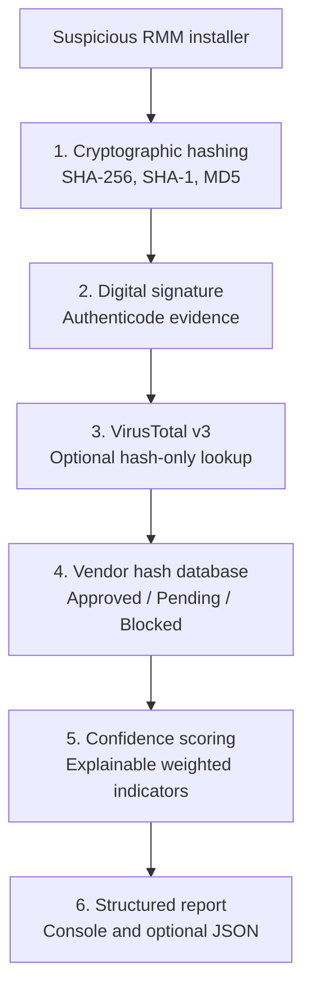
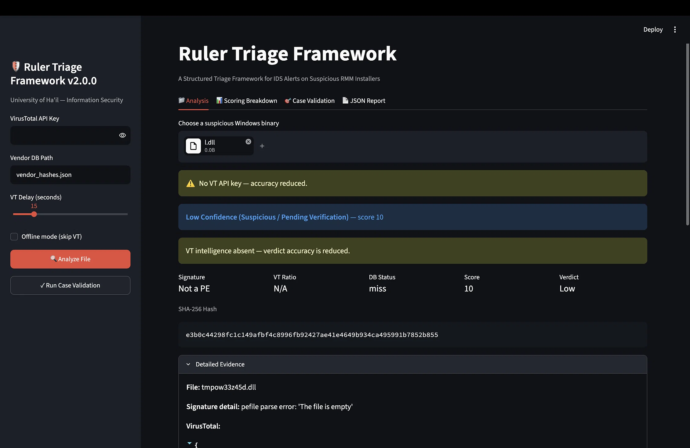
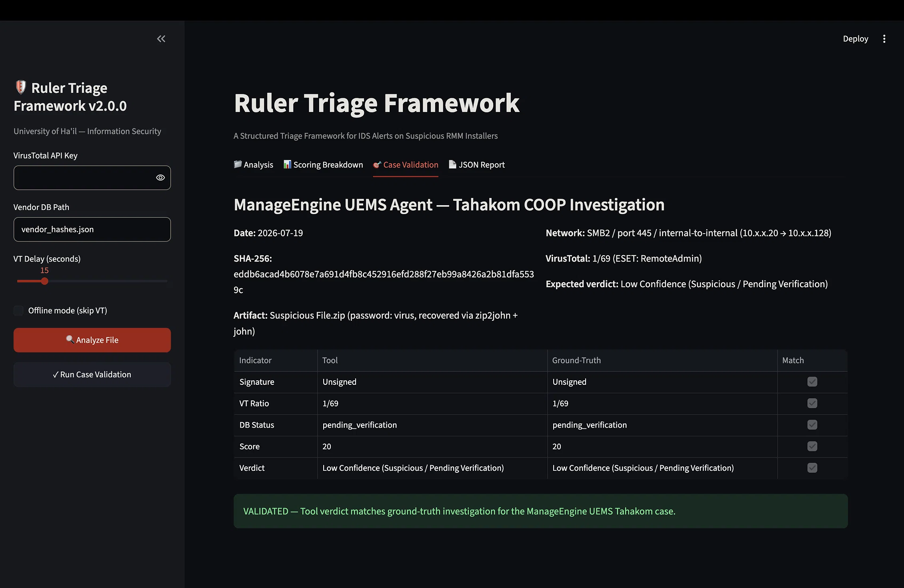

# Ruler Triage Framework

[](https://www.python.org/)
[](https://streamlit.io/)
[](LICENSE)

*A Structured Triage Framework for IDS Alerts on Suspicious RMM Installers — University of Ha'il COOP Project.*

## Executive Summary

Security teams must distinguish malicious activity from legitimate administration while processing a high volume of IDS and endpoint alerts. Remote Monitoring and Management (RMM) software is dual-use: organizations rely on it for support, while adversaries can abuse the same tools for persistence, command and control, or access. CISA's joint advisory AA23-025A documents malicious use of legitimate RMM software, including portable executables that can evade assumptions based on centrally installed software. This ambiguity can increase alert fatigue and delay consistent investigation. ([CISA AA23-025A](https://www.cisa.gov/news-events/cybersecurity-advisories/aa23-025a))

Ruler Triage Framework turns an initial suspicious-installer review into a repeatable six-stage workflow. It collects file hashes, checks Authenticode signature evidence, optionally queries VirusTotal by hash, looks up a status-aware vendor database, applies a transparent heuristic score, and produces a console or JSON report. The scoring model is empirically calibrated against a documented ManageEngine UEMS investigation, giving analysts a consistent starting point for review while preserving human confirmation for operational decisions.

## Architecture Diagram



## The Ground-Truth Case Study (ManageEngine UEMS)

The framework uses a ManageEngine UEMS Agent installer investigated during COOP training at Tahakom as its ground-truth reference. In the case record, the installer was transferred internally over SMB2 on port 445 (10.x.x.20 → 10.x.x.128), was unsigned, and had a VirusTotal detection ratio of 1/69, with ESET classifying it as `RemoteAdmin`. The available evidence did not establish whether the deployment was authorized, so the hash remains `pending_verification` in the vendor database.

The SHA-256 is `eddb6acad4b6078e7a691d4fb8c452916efd288f27eb99a8426a2b81dfa5539c`. The calibrated score is 20: unsigned (+30), one or more VT detections (+20), and a pending database match (−30). The tool therefore returns **Low Confidence (Suspicious / Pending Verification)**, matching the manual analyst verdict exactly. The recommended action is to confirm authorization with IT Operations before closing the alert.

Run the built-in comparison without the original binary:

```bash
python3 ruler_triage.py --validate-case
```

## Installation & Setup

Python 3.10 or newer is required. Create and activate a virtual environment, then install the dependencies listed in `requirements.txt`.

### macOS and Linux

```bash
python3 -m venv venv
source venv/bin/activate
python -m pip install -r requirements.txt
```

### Windows PowerShell

```powershell
py -3 -m venv venv
.\venv\Scripts\Activate.ps1
python -m pip install -r requirements.txt
```

To use VirusTotal, provide an API key with `--vt-key` or set the `VT_API_KEY` environment variable. Without a key, the CLI and GUI can run in offline mode with reduced intelligence.

## Usage — CLI

Analyze a file locally:

```bash
python3 ruler_triage.py suspicious_installer.exe
```

Query VirusTotal using a key, and optionally save a JSON report:

```bash
export VT_API_KEY="your_key_here"  # macOS/Linux
python3 ruler_triage.py suspicious_installer.exe --out triage_report.json
python3 ruler_triage.py suspicious_installer.exe --vt-key YOUR_KEY --out triage_report.json
```

On Windows PowerShell, set the environment variable with `$env:VT_API_KEY = "your_key_here"` before running the command.

Add a hash to the vendor database. New entries default to `pending_verification`:

```bash
python3 ruler_triage.py --add-to-db "<64-character-sha256>:Vendor Name:Product Name"
```

Other useful options include `--version`, `--no-color`, `--quiet`, `--db PATH`, and `--validate-case`. VirusTotal integration performs a hash lookup; it does not upload the file.

## Usage — Streamlit GUI

Launch the local interface from the project root:

```bash
streamlit run app.py
```

The GUI is organized into four tabs:

- **Analysis** — upload a Windows binary, review key indicators and evidence, and download a JSON report.
- **Scoring Breakdown** — inspect the scoring indicators, weights, and rationale.
- **Case Validation** — compare the built-in ManageEngine reference case against the configured database.
- **JSON Report** — review and download the structured analysis report.

Screenshots will be added to `docs/`:





## Confidence Scoring Model

The score is a transparent heuristic to support analyst triage. It is not a standalone malware verdict; the result should be interpreted alongside local telemetry and organizational context.

| Indicator | Points |
|---|---:|
| Unsigned binary | +30 |
| Invalid or tampered Authenticode signature | +30 |
| Signed, structural check only | +10 |
| Any VirusTotal malicious or suspicious detections | +20 |
| Malicious detection rate above 5% | +20 additional |
| Hash absent from vendor database | +10 |
| Vendor database match: `pending_verification` | −30 |
| Vendor database match: `approved` | −80 |
| Vendor database match: `blocked` | +40 |
| Valid signature, no listed risk indicator | 0 |

| Total score | Framework verdict |
|---:|---|
| Below 30 | Low Confidence (Suspicious / Pending Verification) |
| 30–59 | Medium Confidence (Likely Malicious) |
| 60 or higher | High Confidence (Malicious) |

The framework always emits a warning for a pending database match, prompting confirmation with IT Operations. An approved match provides a strong known-good adjustment; a blocked match adds deny-list evidence.

## Testing

Run the test suite from the project root:

```bash
pytest tests/ -v
```

The suite contains **9 tests** covering the ground-truth hash, streaming hashes, vendor database matches and misses, calibrated and high-risk scoring, CLI case validation, scoring rationale, and non-PE handling. The project maintainer reports all 9 tests passing.

## Directory Structure

```text
.
├── ruler_triage.py              # CLI analysis engine and scoring model
├── app.py                       # Streamlit interface
├── vendor_hashes.json           # Status-aware vendor hash database
├── requirements.txt             # Python dependencies
├── Makefile                     # Common development commands
├── tests/
│   └── test_ruler_triage.py     # Engine and CLI tests
├── docs/
│   ├── ACADEMIC_CONTEXT.md      # Academic objective, methodology, and standards mapping
│   ├── sample_triage_report.json
│   └── VERIFICATION.md
├── .streamlit/
│   └── config.toml              # Local Streamlit theme
├── AGENTS.md                    # Project invariants and contributor guidance
├── CHANGELOG.md
├── CONTRIBUTING.md
└── LICENSE
```

## Academic Context

This is a University of Ha'il Information Security COOP project developed in connection with training at Tahakom. It demonstrates how structured evidence collection and transparent, case-driven scoring can support early SOC triage of suspicious RMM installer alerts. Academic supervision: **Dr. Ehab AlNfrawy**.

See [`docs/ACADEMIC_CONTEXT.md`](docs/ACADEMIC_CONTEXT.md) for the project objective, calibration methodology, standards mapping, and limitations.

## License

This project is released under the MIT License. See [`LICENSE`](LICENSE) for the full license text.
